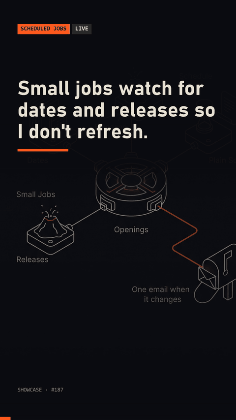

# release-pollers

Single-purpose release pollers: scheduled checks for one specific change each, one email and a clear finish.



## Quick start

```
python demo.py
```

Starts a local page that "releases" on its third request and polls it five times. Tests: `python -m unittest discover -s tests`.

## Requirements

Python 3.8+. No dependencies (standard library only).

## How it works

- Each poller in `pollers.json` (copy `pollers.example.json`) watches one URL for one condition: text appears (`contains`), disappears (`absent`), matches a regex, or the page changes from the first version seen.
- `python -m pollers run` does one pass; schedule it with cron or Task Scheduler.
- When the condition is met, it sends one email and marks itself finished. A finished poller makes no further requests and never sends again.
- Network errors are recorded and retried on the next pass; they are never treated as a result.
- Mail is a dry run by default. Add `--send` and set `SMTP_HOST`, `SMTP_USER`, `SMTP_PASSWORD`, `MAIL_FROM`, `MAIL_TO` in the environment to send for real. Nothing is stored in the repo.
- `python -m pollers status` shows what is still being watched.

## License

MIT. See [LICENSE](LICENSE).

Built with Claude Code. More: https://made-by-asking.pages.dev/showcase/release-pollers/
